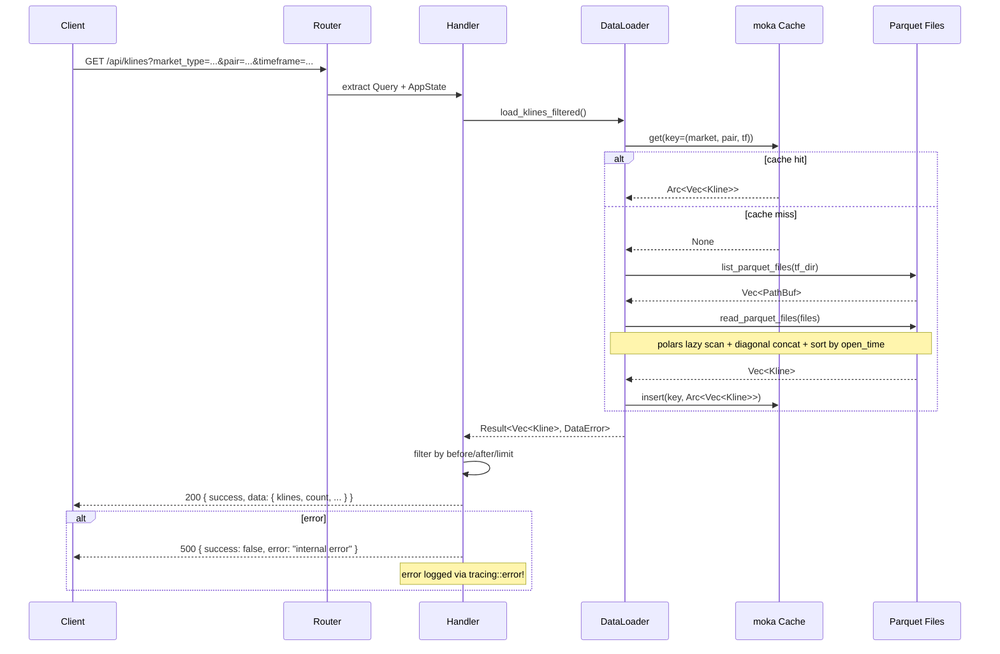
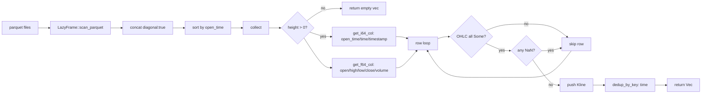

# tradingview-backend

TradingView K-line data local HTTP service. Reads candlestick data from local parquet files (futures/spot markets) and serves them via REST API.

## 配置

```toml
[package]
name = "tradingview-backend"

[[bin]]
name = "tradingview"

[dependencies]
axum          # HTTP router
tower-http    # CORS + static file serving
clap          # CLI args + env var config
moka          # in-memory cache (TTL 5min, cap 200)
polars        # parquet reading via lazy scanning
serde/serde_json  # serialization
tokio         # async runtime
thiserror     # typed error enums
tracing       # structured logging
chrono        # timestamps
```

CLI arguments:

| Flag | Env | Default | Description |
|------|-----|---------|-------------|
| `--host` | `HOST` | `127.0.0.1` | Listening address |
| `--port` | `PORT` | `3001` | Listening port |
| `--data-dir` | `DATA_DIR` | auto-detect | Parquet data root |

## 主执行流程

```
main()
 ├─ tracing_subscriber::fmt() — init structured logging
 ├─ Args::parse() — parse CLI / env
 ├─ AppState::new(data_dir) — create DataLoader (moka cache)
 ├─ create_router() — register REST routes
 ├─ CorsLayer::new() — open CORS (all origins)
 ├─ ServeDir("frontend/dist") — static fallback for SPA
 └─ tokio::net::TcpListener::bind + axum::serve
      └─ accept requests ──► route handlers
```

### step 1 — API request lifecycle



### step 2 — parquet file loading



### step 3 — directory layout

```text
{data_dir}/
├── futures/um/daily/klines/
│   ├── BTCUSDT/
│   │   ├── 1h/
│   │   │   ├── BTCUSDT-1h-2024-01-01.parquet
│   │   │   └── BTCUSDT-1h-2024-01-02.parquet
│   │   └── 1d/
│   │       └── BTCUSDT-1d-2024-01-01.parquet
│   └── ETHUSDT/
│       └── 1h/
│           └── ETHUSDT-1h-2024-01-01.parquet
└── spot/daily/klines/
    └── BTCUSDT/
        └── 1h/
            └── BTCUSDT-1h-2024-01-01.parquet
```

## 用法

```bash
# from workspace root
cargo run -p tradingview-backend

# with custom port and data dir
DATA_DIR=/path/to/data cargo run -p tradingview-backend -- --port 8080

# http://localhost:3001/api/klines?market_type=futures&pair=BTCUSDT&timeframe=1h
```
